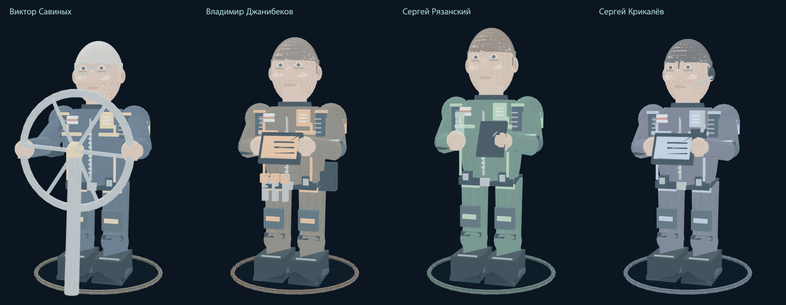
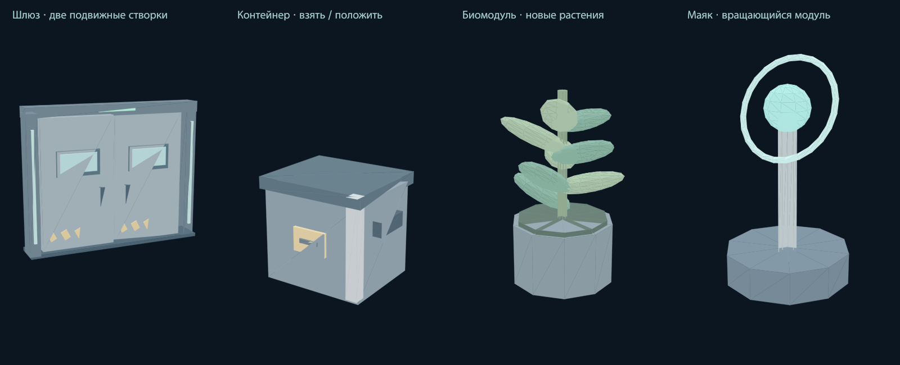
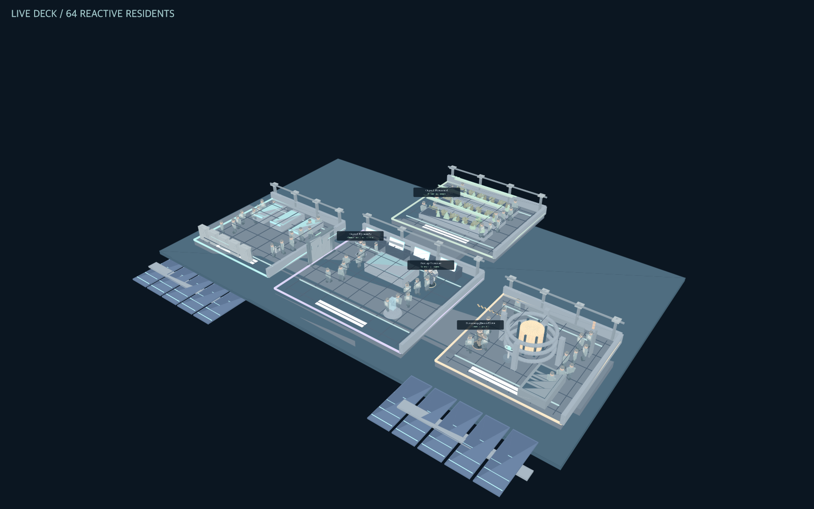

# Обновление к воскресенью · 1 ноября 2026

## Что реализовано

| Требование | Реализация |
|---|---|
| Фронт регистрации/авторизации | Оформление из FIZMA адаптировано к существующим формам и настоящему Go API. Позывной, пароль, подтверждение, видимость пароля, ошибки, сохранённая cookie-сессия. Next.js для запуска не требуется. |
| Админ-панель | Владелец экспедиции редактирует её мир: освещение, число жителей, скорость анимаций, предметы и поведение четырёх наставников. Остальные участники могут взаимодействовать с предметами и давать просьбы агентам. |
| FPS + ping | Каждый подключённый клиент отправляет замер раз в 3 секунды. FPS считается по фактически нарисованным кадрам; ping — реальный RTT сообщения ping/pong. Владелец видит всех участников своей комнаты, отметки отсутствующих/устаревших данных, скрытые вкладки, интервал кадра, draw calls и треугольники. |
| Составные анимации | Плечевые и тазобедренные узлы персонажей, движения рук, ног, головы, штурвала. У дверей раздвигаются створки, у растений качаются листья, у маяков вращается кольцо. |
| Интерактивные объекты | Сервер проверяет расстояние и занятость контейнера. Взять, перенести, положить; открыть/закрыть шлюз. Дверь блокирует движение и на сервере. Визуальное затухающее подпрыгивание при укладке контейнера; полноценный физический движок не добавлен. |
| Массовые простые NPC | 64 техника по умолчанию, до 160. Ходьба, остановка рядом с игроком и поворот к разговору. В WebGL используются 12 instanced-групп частей тела; Canvas использует обычные меши. Это отдельный класс, без RAG/LLM. |
| Агенты меняют мир | Ограниченный классификатор повелительных команд в обычном диалоге и панели создаёт растения, снабжение и маяки, управляет шлюзами и светом. Режим поведения ограничивает доступные действия. |
| Более подробные модели | Униформа, наплечники, нашивки, молнии, ремни, рюкзаки, пальцы, наколенники, обувь и детали лица. Предметы также состоят из нескольких деталей. Ресурсы создаются локально, внешние загрузки не нужны. |

## Как показать за несколько минут

1. Запустите игру через `Start.command` / `Start.bat` / `Start.sh`. Зарегистрируйтесь, создайте экспедицию и начните одиночную миссию с универсальной ролью.
2. Откройте «Администратор» → «Вселенная». Измените свет и число NPC, примените. На вкладке «Агенты» переключите наставника в патруль, затем найдите его в 3D.
3. В криоотсеке рядом со стартом стоит контейнер снабжения. «Исследовать» → подойти → E → пройти несколько шагов → G. Либо используйте кнопки «Взять»/«Положить» во вкладке предметов; расстояние всё равно проверяется.
4. Попросите наставника-помощника «Создай сад». Перейдите в оранжерею: появятся четыре гидропонных модуля. «Убери растения» изменит состав объектов. «Открой двери» откроет шлюзы.
5. Подойдите к группе техников и отправьте сообщение: ближайшие остановятся и повернутся. Они также останавливаются при приближении игрока.
6. Подключите второго участника под другим аккаунтом по коду. Проверьте общий предмет и освещение. У владельца откройте «Клиенты»: после первых измерений видны FPS и ping обоих клиентов.
7. Перезапустите сервер: аккаунты, комната и изменённое окружение восстанавливаются. Метрики заполняются заново.

## Режимы агентов

- Помощник выполняет все поддерживаемые команды окружения.
- Патруль движется возле поста, размещает снабжение и маяки.
- Охрана наблюдает за игроком, управляет шлюзами и маяками.
- Наблюдатель не изменяет мир. Обычный справочный диалог сохраняется.

Команды понимаются по ограниченному словарю. Вопросы с вопросительным знаком и отрицания не выполняются как действия. Неизвестные команды получают объяснение. Максимум — 80 интерактивных/создаваемых объектов; игровые ресурсы и циклы эти просьбы не расходуют.

## Сохранение и синхронизация

Настройки и объекты находятся в `Room.Universe`, сохраняются в существующую SQLite-базу и транслируются WebSocket-событием `universe.state`. Мутации используют текущую версию состояния; при конфликте клиент обновляется и просит повторить действие. Идентификатор пользователя берётся из сессии, права владельца проверяются на сервере. Нельзя взять занятый предмет, положить чужой или взаимодействовать издалека. Отключение владельца контейнера освобождает предмет; после рестарта перенесённые, но не положенные предметы также освобождаются. Комнаты изолированы, в том числе по телеметрии. Сброс миссии восстанавливает начальную вселенную.

Толпа — визуальная симуляция на каждом клиенте. Точные положения техников и их реакция на локальный разговор не передаются по сети; предметы, поведение наставников, освещение и численность общие. Это позволяет оставить много жителей без высокой сетевой нагрузки. FPS и ping являются клиентскими диагностическими замерами, а не доверенными показателями для игровых наград.

## Проверки

Проверки интерфейса с DOM-фикстурами не заменяют проверку в браузере. Автоматизация браузера в текущей среде недоступна: подключение Browser остановилось на запрещённом импорте среды, изолированный Chrome завершился при запуске. Поэтому внешний вид всей страницы, pointer lock и аппаратный WebGL на целевых ноутбуках требуют ручной проверки.

Финальный прогон:

- `go test ./...` — все пакеты прошли.
- `go vet ./...` — без замечаний.
- `go test -race ./internal/game ./internal/server ./internal/realtime` — прошёл. После уточнения области событий повторно прошёл `go test -race ./internal/server ./internal/game -run TestUniverse -count=1`.
- `npm test` — пять наборов проверок: авторизация, команды панели, DOM-события/состояния панели, существующая сцена, новый живой мир. Включены регрессии поздних событий из другой комнаты и конфликтующих настроек освещения.
- Все 14 модулей `web/src` прошли `node --check`.
- `test-software-lighting.mjs` — реальные пиксели Canvas меняются при смене света и яркости; свечение объектов работает в темноте. Требуется `@napi-rs/canvas`; можно указать каталог зависимостей через `CODEX_PRIMARY_RUNTIME_NODE_MODULES`.
- `verify-world.mjs` — SHA-256 всех 309 ресурсов, 24 чанка, 1396 мешей, 4 персонажа.
- `build_crew_corpus.py --check` — корпус прошёл проверку.
- `scripts/build-all.py` — успешно собраны шесть файлов: сервер и MCP для Linux amd64, Windows amd64, macOS arm64.
- `go run ./cmd/smoke-release ./bin/game-server-macos-arm64` — проверен настоящий собранный сервер: регистрация, встроенный фронтенд совпадает с исходниками, два WebSocket-клиента, общее окружение, перенос предмета, просьба создать сад, клиентская телеметрия, MCP, операция/лаборатория, завершение процесса и восстановление SQLite. [Машиночитаемый результат](sunday/compiled-host-check.json).

Реально запущен macOS arm64-бинарник; Windows/Linux собраны перекрёстно, запуск на этих ОС не проверялся. Число 160 NPC проверено структурно, без заявления о целевом FPS на пользовательском оборудовании. Реальная сеть из нескольких ноутбуков и аппаратный WebGL здесь не проверены.

## Просмотр моделей

Это изображения реальной геометрии, отрисованные `SoftwareRenderer`, а не скриншоты браузера. Для воспроизведения используйте `scripts/render-sunday-review.mjs` с установленным `@napi-rs/canvas`.

